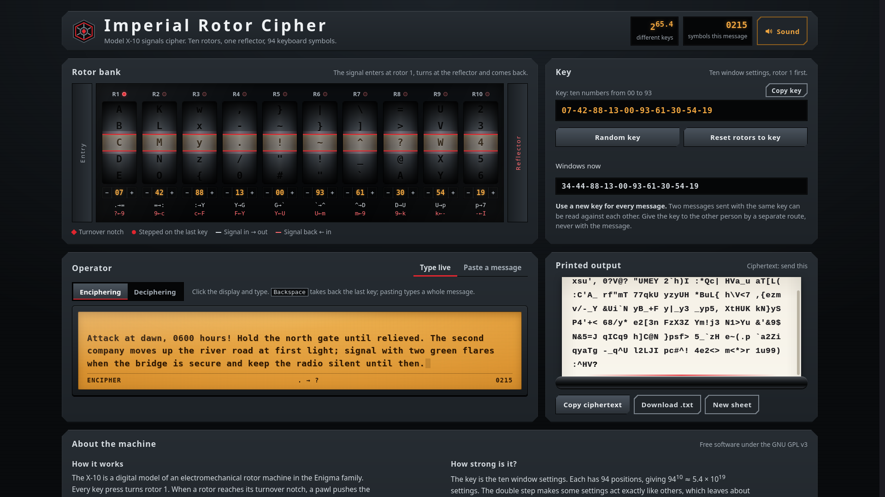

# Imperial Rotor Cipher

A ten-rotor cipher machine in the Enigma family, built as a digital model of an electromechanical machine. It is one HTML file that runs offline in any modern browser. There is nothing to install, no account, and no network access.

**Use it:** download `index.html` and open it in your browser.



## What it does

- **Ten rotors and a reflector** over the 94 visible keyboard characters (`!` to `~`).
- **The key is the ten rotor window settings.** Set them by hand, or press *Random key*.
- **Enigma stepping.** Each key press turns rotor 1. When a rotor sits at its turnover notch, a pawl pushes the next rotor along and the notched rotor with it, which is Enigma's double step.
- **Self-inverse.** The same key and the same operation encipher and decipher. As with Enigma, no symbol ever enciphers to itself.
- **Space is sent as `~`.** Line breaks are sent as `~` too, and `~` reads back as a space. This means a typed `~` also comes back as a space.
- **Ciphertext is printed in groups of five.** Spacing and line breaks are ignored when deciphering. A wrong symbol spoils only that symbol, but a missing or extra symbol garbles everything after it.
- **Curly quotes, dashes and the ellipsis** from word processors and phones are changed to their plain keyboard forms. Other characters outside the 94 (tabs, accented letters, emoji) are refused.
- **Two ways to work:**
  - *Type live*: type on the backlit display, like a modern electric typewriter. Each key turns the drums, shows its signal path, and prints one symbol on the paper, with an optional mechanical click. Backspace takes back the last key, and pasting types a whole message.
  - *Paste a message*: run a whole message at once. It prints at 12 characters a second, the rated speed of electronic typewriters sold today, with the drums turning as it goes. *Finish now* (or Escape) completes it at once.
- **Enciphering or Deciphering.** When enciphering, a typed space shows as a space on the display and is enciphered as `~` inside the machine. When deciphering, the spaces between ciphertext groups are skipped, and every `~` prints as a space.

## How strong is it?

**Number of keys.** Each rotor window has 94 settings, so ten rotors give 94¹⁰ ≈ 5.4 × 10¹⁹ settings, about 2^65.55.
- The double step makes some settings behave exactly like others. That leaves about **2^65.4 distinct keys**, which is above 64 bits.
- Nine rotors would give only about 2^59. (The exact distinct-key count, 49,490,336,166,897,450,358, is recomputed by the tests.)

**What that number does not mean.** 64 bits counts the keys. It is not the work needed to break a message.
- Rotor 2 turns once every 94 symbols, and rotor 3 roughly once every 8,800. So in a short message the slow rotors usually stand still, or turn only once or twice.
- Between those moments, rotors 3 to 10 and the reflector act as one fixed scrambler.
- So someone who knows or guesses part of a message tries about 94² ≈ 8,800 settings, not 2^64.

That is the kind of weakness that brought down Enigma. **Use this machine for learning, puzzles and fun, not for real secrets.**

**Practical rules:**
- Use a new key for every message. Two messages under the same key can be read against each other.
- Send the ciphertext as a file, an email, or a code block. Chat apps can treat `*`, `_`, `~` and `` ` `` as formatting and drop them.

## The published parts

- The ten rotor wirings, their turnover notches and the reflector are fixed and public (Kerckhoffs's principle).
- They are generated from the seed `IMPERIAL-ROTOR-CIPHER/parts/v1` by `tools/gen-parts.js`. Run that script to check the constants in the app.
- Rotor 10's notch is published but has no effect, because there is no pawl beyond rotor 10.

## For developers

| Path | What it is |
|------|------------|
| `index.html` | The app, built from `src/` |
| `src/core.js` | Cipher core, with no page code |
| `src/ui.js`, `src/styles.css`, `src/template.html` | The console |
| `tools/build.js` | Builds `index.html` from `src/` |
| `tools/gen-parts.js` | Regenerates the published rotors and reflector |
| `tests/test-core.js` | Core tests (Node 18+) |
| `docs/design.md` | The design |

To build and test:

```
node tools/build.js
node tests/test-core.js
```

The page also has a **Run self-test** button under *About the machine*.

## License

Copyright © 2026 Antonio. Free software under the GNU General Public License v3.0 or later; see [LICENSE](LICENSE).

The look is an original "imperial console" style. It is not affiliated with, endorsed by, or using material from any film franchise.
